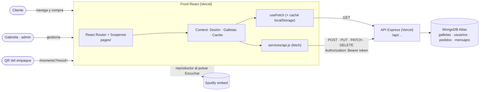

# Bity Bites Cookies 🍪 — Frontend (Proyecto final Fullstack)

Tienda online de **Bity Bites Cookies**, el emprendimiento de NY cookies artesanales de Gabriela en Valdemoro (Madrid).
Hecha con **React + Vite** y conectada a una API REST propia (Express + MongoDB Atlas).

- 🌐 **Web publicada:** https://bitybitescookies.vercel.app
- 🔌 **API publicada:** https://bity-bites-api.vercel.app/api/galletas · repo [`bity-bites-api`](https://github.com/vanessvalentina/bity-bites-api)
- 🗄️ **Base de datos:** MongoDB Atlas (`bitybites`)

## Qué se puede hacer
| Sección | Ruta | Qué hace |
|---|---|---|
| Inicio | `/` | Hero, catálogo con filtro (clásicas / rellenas), preview de packs y making of |
| Packs | `/packs` | Pack de 3 clásicas, "Arma tu caja" y encargos / regalos |
| Música | `/momento` | Una playlist de Spotify por galleta. Destino de los QR del empaque (`/momento?mood=cozy`) |
| Sobre Gabriela | `/gabriela` | Quién es, cómo es una NY cookie (infografía) y del bol a tu mano |
| Contacto | `/contacto` | Formulario de encargos que se guarda en MongoDB |
| Tu combo | `/carrito` | Carrito + pedido como invitado o con cuenta |
| Entrar | `/login` | Login y registro (contraseñas con bcrypt en la API) |
| Mi cuenta | `/perfil` | Historial de pedidos y editar perfil / contraseña |
| Panel de Gabriela | `/admin` | **Solo rol admin**: pedidos (cambiar estado), mensajes, catálogo (CRUD) y su cuenta |
| Privacidad | `/privacidad` | Política de privacidad (RGPD) |

**Login y permisos:** sin sesión se puede ver todo y comprar como invitado. Crear, editar y borrar galletas
(CUD) solo lo puede hacer Gabriela (rol `admin`); la API lo comprueba con JWT.

## Flujo de la app



## Estructura
```
src/
  App.jsx          rutas (createBrowserRouter + lazy/Suspense), sesión, galletas y carrito (Context)
  main.jsx         punto de entrada
  pages/           Inicio, Packs, Musica, Gabriela, Contacto, Carrito, Login, Perfil, Admin, Privacidad, Error404
  components/      Navbar (megamenú), Footer, GalletaCard, Pedido, Mensaje, ModalEditar, ModalBorrar,
                   EditarPerfil, AvisoRegistro, MoodCard, PasoProceso, LogoB, IconoCarrito, Flecha, Cargando…
  context/         SesionContext, GalletasContext, CarritoContext
  hooks/           useFetch (GET + estado de carga/error + caché en localStorage)
  services/        api.js (peticiones con fetch y token)
  const/           constantes.js (UPPER_SNAKE_CASE: API_URL, PACK_TRES, MOODS_MUSICA, NAV_ENLACES…)
  index.css        estilos propios (variables de color, responsive)
public/            imágenes optimizadas (≤ 900 KB), logo y renders
vercel.json        rewrites para que las rutas de React funcionen al recargar o desde un QR
```
Importaciones absolutas con el alias `@/` (configurado en `vite.config.js` y `jsconfig.json`).

## Variables de entorno
Crea un `.env` a partir de `.env.example`:
```
VITE_API_URL=http://localhost:4000/api
```
En Vercel (*Settings → Environments → Production*): `VITE_API_URL=https://bity-bites-api.vercel.app/api`.

## Instalar y ejecutar en local
Hace falta la API encendida (ver su README). Después, en esta carpeta:
```bash
npm install
npm run dev
```
Abre http://localhost:5173

Para la versión de producción: `npm run build` (genera `dist/`). Vercel lo hace solo en cada `git push`.

## Endpoints que usa
| Método | Ruta | Dónde |
|---|---|---|
| GET | `/api/galletas` | Catálogo, Packs, Música (useFetch) |
| POST / PUT / DELETE | `/api/galletas(/:id)` | Panel de Gabriela (CRUD, con token admin) |
| POST | `/api/usuarios/login` · `/registro` | Login y registro |
| PUT / PATCH | `/api/usuarios/perfil` · `/password` | Editar perfil |
| POST | `/api/pedidos` | Hacer pedido (invitado o cliente) |
| GET | `/api/pedidos/mios` · `/api/pedidos` | Mis pedidos · todos (admin) |
| PATCH | `/api/pedidos/:id` | Cambiar estado (admin) |
| POST / GET / PATCH / DELETE | `/api/mensajes(/:id)` | Contacto y bandeja de Gabriela |

## Stack
React 19 · Vite · React Router (createBrowserRouter, lazy, Suspense) · Context API · Fetch · localStorage ·
CSS propio (Fraunces, Fredoka, Hanken Grotesk) · Spotify embed · Vercel

Proyecto del módulo Fullstack del máster (CEI). Autora: Vanessa Izturriaga.
